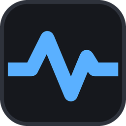
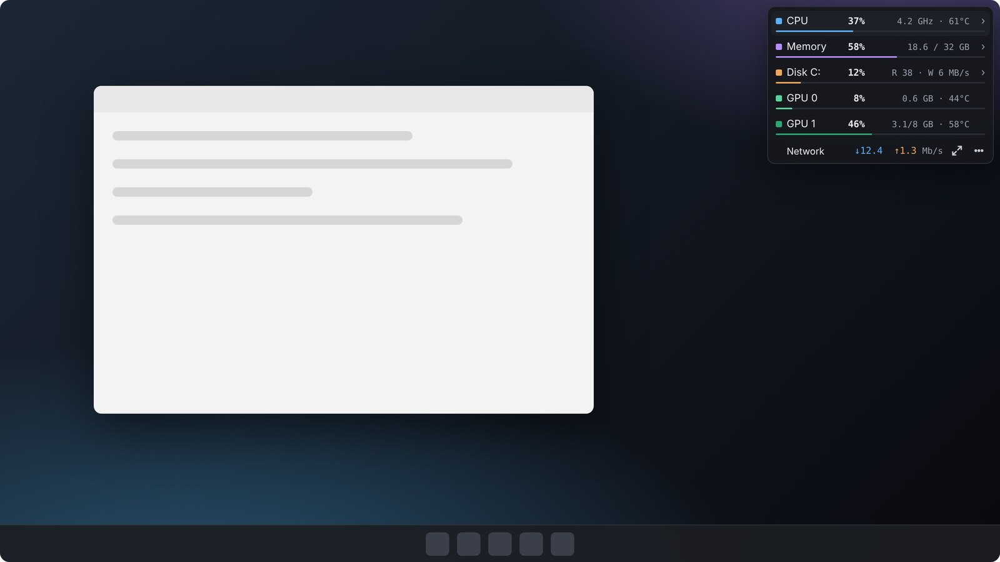
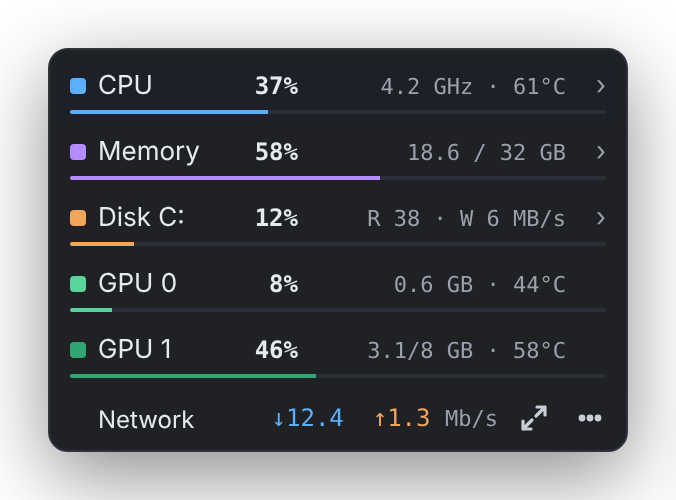
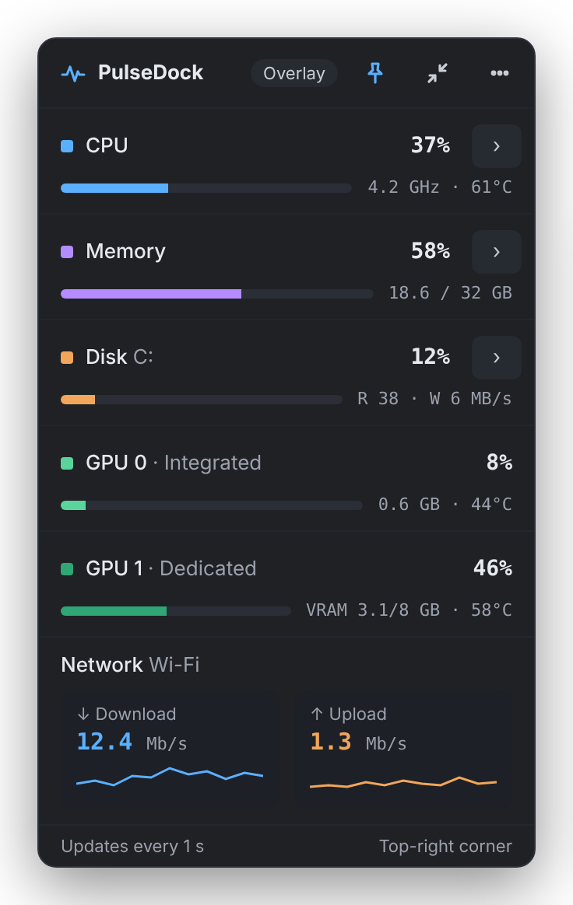
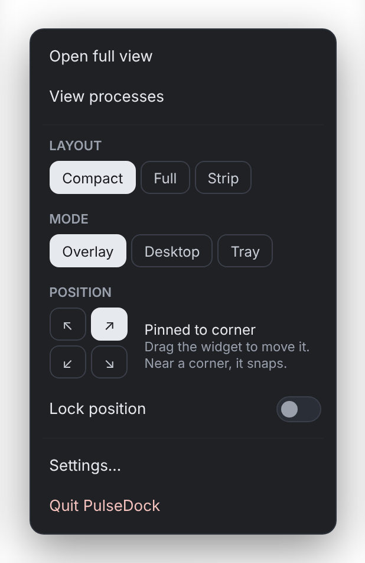
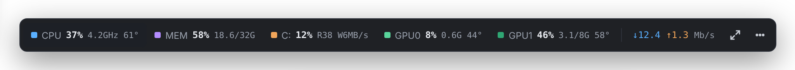
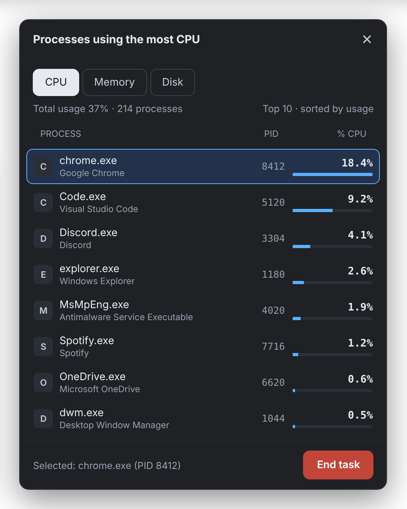
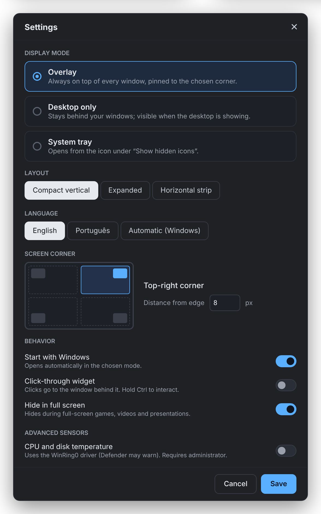

<p align="center"></p>

<h1 align="center">PulseDock</h1>

<p align="center">
  Um monitor de sistema pequeno e sempre visível para Windows: CPU, memória, disco, as duas GPUs e rede, num canto da tela.<br>
  <a href="README.md">English</a> · <b>Português</b>
</p>

<p align="center">
  <a href="https://github.com/filipembcruz/pulsedock/releases/latest/download/PulseDock.exe"><b>⬇ Baixar PulseDock.exe</b></a>
  &nbsp;·&nbsp; Windows 10 (2004+) / 11 · 64 bits · gratuito e de código aberto (MIT)
</p>



> As imagens mostram a interface em inglês, que é o padrão. Para usar em português, vá em *Settings → Language → Português*.

## Instalação (1 minuto)

1. **Baixe** o [`PulseDock.exe`](https://github.com/filipembcruz/pulsedock/releases/latest/download/PulseDock.exe). Todas as versões ficam na página de [Releases](https://github.com/filipembcruz/pulsedock/releases).
2. **Execute.** Não há instalador nem nada mais para instalar: o .NET já vem dentro do `.exe`.
   - *Dica:* antes, mova o arquivo para uma pasta definitiva, como `C:\Ferramentas\PulseDock`, porque os atalhos apontam para onde o arquivo está.
3. **Pronto.** Na primeira execução, o PulseDock cria o atalho **PulseDock** no **Menu Iniciar** e na **área de trabalho**. Use-o para abrir de novo depois de sair.
4. **Para mudar para português:** clique em **⋯ → Settings… → Language → Português → Save**.

> **Aparece "O Windows protegeu o computador"?** É o SmartScreen. Ele aparece para qualquer app novo sem assinatura digital (os certificados são pagos). Clique em **Mais informações → Executar assim mesmo**. O `.exe` é gerado pelo GitHub Actions a partir do código deste repositório.

**Desinstalar:** saia do PulseDock (⋯ → *Sair*) e apague o `.exe`, os atalhos e a pasta `%APPDATA%\PulseDock`. Se ativou *Iniciar com o Windows*, desative antes de sair.

## Imagens

| Compacto (padrão) | Visão completa | Menu rápido |
|:---:|:---:|:---:|
|  |  |  |

**Faixa horizontal**



| Processos · finalizar tarefa | Configurações |
|:---:|:---:|
|  |  |

## Recursos

- **Num relance**
  - **CPU:** uso, frequência e temperatura¹.
  - **Memória:** usada / total.
  - **Disco:** atividade, velocidade de leitura e escrita, e temperatura¹.
  - **GPU 0 (integrada) e GPU 1 (dedicada):** uso, VRAM e temperatura. A da dedicada aparece enquanto ela está em uso, para nunca acordá-la.
  - **Rede:** download e upload, com mini gráfico.
- **Descubra o que está pesando:** clique em CPU, Memória ou Disco para ver o top 10 de processos e usar **Finalizar tarefa**, com confirmação. Processos essenciais do Windows ficam protegidos.
- **Três layouts:** compacto vertical (padrão), visão completa e faixa horizontal.
- **Três modos:**
  - **Sobreposto:** sempre no topo.
  - **Só na área de trabalho:** atrás das janelas.
  - **Bandeja do sistema:** abre pelos ícones ocultos.
- **Onde você quiser:**
  - Fixe em qualquer um dos 4 cantos.
  - Arraste para qualquer lugar; perto de um canto, ele encaixa.
  - Trave a posição.
  - Escolha o monitor e a distância da borda.
- **Extras:**
  - Clique atravessa o widget; segure **Ctrl** para interagir.
  - Some durante jogos e vídeos em tela cheia.
  - Inicia com o Windows.
  - Opacidade do widget e intervalo de atualização ajustáveis.
- **Idiomas:** inglês (padrão) e português. Troque em *Configurações → Idioma*, ou escolha *Automático* para seguir o Windows.

¹ As temperaturas de CPU e disco são opcionais. Veja [Temperaturas e antivírus](#temperaturas-e-antivírus).

## Como usar

| Para… | Faça |
|---|---|
| Abrir a visão completa | Clique em **⤢** |
| Trocar layout, modo ou canto, travar a posição, sair | Clique em **⋯** ou com o botão direito no widget |
| Mover o widget | Arraste de qualquer ponto. Solte perto de um canto para encaixar |
| Ver e finalizar processos pesados | Clique na linha de CPU, Memória ou Disco |
| Mudar idioma, métricas, opacidade, inicialização | ⋯ → **Configurações…** |
| Perdeu o widget de vista? | Ícone da bandeja → **Voltar o widget para o canto** |

As configurações ficam em `%APPDATA%\PulseDock\settings.json`, e o log em `log.txt`, na mesma pasta.

## Temperaturas e antivírus

- **As GPUs não usam driver.** Uso, VRAM e temperatura vêm das mesmas APIs do Windows que o Gerenciador de Tarefas usa.
- **A temperatura da CPU e do disco é opcional e vem desligada.** Ative em *Configurações → Sensores avançados*.
  - Ela usa o driver **WinRing0** da biblioteca [LibreHardwareMonitor](https://github.com/LibreHardwareMonitor/LibreHardwareMonitor), e só funciona com o PulseDock executando **como administrador**. O botão *Reiniciar como admin* fica na mesma seção.
  - O Microsoft Defender marca esse driver como `HackTool:Win32/Winring0`. Ele não é vírus, mas o driver tem uma falha conhecida.
  - Com a opção desligada, o driver nunca é extraído nem carregado.

## Solução de problemas

**A tela fica preta ou congela por um instante ao usar o navegador ou vídeo (notebooks com duas GPUs).** Corrigido na v0.2:
- o widget não é mais uma janela com transparência por pixel;
- ele não reenvia mais o "sempre no topo" a cada 2 s;
- ele nunca acorda a GPU dedicada só para ler a temperatura.

Se ainda acontecer, dá para desligar recursos um de cada vez:

1. Saia do PulseDock (⋯ → *Sair*).
2. Abra `%APPDATA%\PulseDock\settings.json` no Bloco de Notas e edite o bloco `Diagnostics`:

   ```json
   "Diagnostics": {
     "GpuTemperature": "auto",       // "auto" (padrão) | "always" | "off"
     "GpuCounters": true,            // false = não lê uso/memória das GPUs
     "ReassertTopmost": false,       // true = comportamento antigo (reafirma "no topo" a cada 2 s)
     "PerPixelTransparency": false   // true = comportamento antigo (janela com transparência por pixel)
   }
   ```
3. Abra o PulseDock de novo.

O `log.txt`, na mesma pasta, registra quais chaves estavam ativas na inicialização.

Para o menor peso no sistema gráfico, mantenha a **opacidade em 100%** e o **clique atravessa desligado**. Os dois recursos exigem uma janela "em camadas", que custa mais para desenhar. O PulseDock só liga esse modo enquanto um deles está em uso.

**A GPU dedicada aparece "em repouso", sem temperatura.** É proposital. Em notebooks com duas GPUs, a dedicada dorme quando não está em uso, e pedir a temperatura a ela a acordaria. A temperatura aparece assim que algo usa essa GPU.

## Compilar a partir do código

Só é preciso se você quiser mexer no código.

1. Instale o [.NET 8 SDK](https://dotnet.microsoft.com/download/dotnet/8.0), ou rode `winget install Microsoft.DotNet.SDK.8`.
2. Clone o repositório e dê dois cliques em **`build.bat`**. Ele:
   1. compila um `PulseDock.exe` único e autossuficiente;
   2. instala o app em `%LOCALAPPDATA%\Programs\PulseDock`;
   3. abre o app.

Ou compile manualmente:

```bat
dotnet publish src\PulseDock\PulseDock.csproj -c Release -r win-x64 --self-contained true -p:PublishSingleFile=true -o dist
```

**Seu próprio fork:** cada envio para a `main` compila o app no GitHub Actions e publica uma nova **Release** com o `PulseDock.exe`. O `publish-github.bat` cria o repositório e envia o código a partir do seu PC; antes, troque `REPO` no topo do arquivo.

### Estrutura do projeto

```
src/PulseDock/
  Services/    coleta de dados (CPU, memória, disco, rede; GPU via D3DKMT + contadores de desempenho;
               LibreHardwareMonitor opcional), idiomas (Loc.cs), posicionamento de janelas, Win32
  ViewModels/  estado das telas
  Views/       widget, menu rápido, processos, configurações, painel da bandeja
  Themes/      cores, estilos e os três layouts do widget
docs/screenshots/
```

**Traduções:** todos os textos da interface estão em `src/PulseDock/Services/Loc.cs`, em pares inglês/português. Pull requests com novos idiomas são bem-vindos.

Tecnologias: C# · .NET 8 · WPF · [LibreHardwareMonitorLib](https://github.com/LibreHardwareMonitor/LibreHardwareMonitor) (sensores opcionais).

## Licença

[MIT](LICENSE). Pode usar, modificar e compartilhar à vontade.
